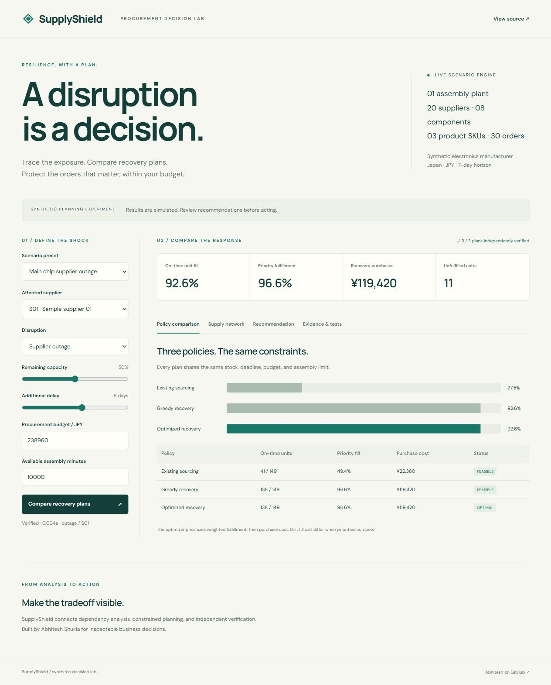
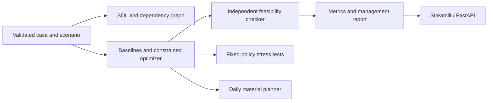

# SupplyShield

Supplier disruption and recovery planning for a synthetic electronics assembler. Identify exposed components, compare sourcing policies, and review capacity-, inventory-, deadline-, and budget-constrained recommendations.

**[Live decision lab](https://snow-warrior07.github.io/supplyshield/)** · [Phase plan](planning/phase-plan.md) · [Results by phase](planning/phase-results.md) · [Placement preparation](planning/placement-preparation.md)



## The business decision

When a chip supplier is unavailable, what should a procurement manager buy from qualified alternatives, and which priority orders can still be fulfilled? SupplyShield makes the service/cost tradeoff visible and preserves the inputs behind the recommendation. No purchase is executed.

The included sample contains 20 fictional suppliers, eight components, three product SKUs, and 30 customer orders. All records and business benefits are synthetic. Location labels are not used to infer supplier risk.

## What is implemented

- Supplier/component/product dependency graph and normalized SQL analysis.
- Outage, reduced capacity, delay, procurement-budget, and assembly-capacity scenarios.
- Existing sourcing, deterministic greedy recovery, and two-stage constrained optimization.
- Independent checks for material balance, shared shipping-mode capacity, budget, and assembly usage.
- Management report and complete scenario exports.
- Streamlit application and FastAPI `/simulate`, `/stress`, `/daily`, `/sample`, `/health` endpoints.
- Fixed-policy stress testing without perfect future information.
- Daily production and component conservation with individual order deadlines.
- Public browser demo with built-in live verification tests.

The public demo uses exact bounded enumeration for the included three-SKU fixture. The extensible Python engine uses OR-Tools CP-SAT. Their priority objective, cost, and feasibility have been compared on 24 scenarios. The browser demo does not silently depend on a Python service hosted by GitHub Pages.

## Run locally

```bash
python -m venv .venv
# Windows: .venv\Scripts\activate
# macOS/Linux: source .venv/bin/activate
pip install -r requirements.txt
python -m streamlit run app.py
```

For the API, in a separate terminal:

```bash
python -m uvicorn api:app --host 127.0.0.1 --port 8765
```

Use `/docs` for interactive API schemas. Deployment to a shared/private-data service needs authentication, authorization, TLS, durable storage, and an operational review; the shipped local API is a prototype with public sample data.

## Verify

```bash
python -m pytest -q
python -m ruff check .
python scripts/evaluate.py
node scripts/browser_engine_tests.mjs
# Requires the separately running API above:
python scripts/live_tests.py
```

Open the live demo, choose **Evidence & tests**, and run its browser checks. Recorded results and scenario benchmarks are in [`test-results/`](test-results/). GitHub Actions status is supplementary; local/live execution evidence is published separately.

## Model and evidence

The static model uses whole-unit quantities and JPY in whole yen, a common seven-day deadline, start-of-horizon procurement, and a declared assembly/delivery reserve. Normal and expedited offers share physical supplier-component capacity. Partial order fulfillment is allowed. First maximize priority-weighted fulfillment, then minimize purchase cost where optimality is proven. A feasible incumbent is not reported as globally optimal.

The daily API adds day-indexed material conservation, daily and total assembly limits, and each order's deadline. It does not model actual factory scheduling or arbitrary multi-tier supplier production.

The hand-calculated reference has 20 chips, 20 housings, and demand for 20 controllers needing two chips each. After the main supplier outage, ten alternative chips allow 15 controllers: **75% unit fill and JPY 200 in modeled purchases**. This is a correctness fixture, not a commercial achievement.

User validation and actual operational savings require a permitted pilot. [Pilot proposal](planning/pilot-proposal.md) records what remains to validate. Carbon estimates, supplier reliability predictions, and certifications are not claimed.

## Architecture



## Sources and attribution

- [Accenture supply-chain resilience case study](https://www.accenture.com/en/case-studies/supply-chain-operations/risk-management-supply-chain-resilience)
- [OR-Tools CP-SAT](https://developers.google.com/optimization/cp/cp_solver)
- [Streamlit deployment](https://docs.streamlit.io/deploy/streamlit-community-cloud/deploy-your-app/deploy)

This is an independent portfolio project by Abhitesh Shukla, not an Accenture product or certification. The dataset is generated in this repository. Code is MIT licensed.
