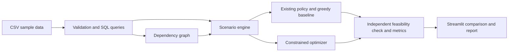

# SupplyShield: phase-by-phase project and placement preparation plan

## Objective and schedule

Build a supplier disruption and recovery decision tool for a fictional small electronics manufacturer serving customers in Japan. A procurement manager should be able to select a disruption, see which products and orders are exposed, compare feasible recovery policies, and download a recommendation with its evidence and assumptions.

The first milestone is a deployed, evaluated MVP by Day 14. Assume approximately four focused project hours and two placement preparation hours per day, with 15 minutes of Japanese practice. These are effort estimates, not a guarantee. Keep Days 13-14 protected for deployment and interviews. Advanced phases extend the project through Weeks 3-6 and are optional after the drive deadline.

The campus JD confirms resume screening, an online technical test, and approximately two interviews at Manager and Director level. It does not specify a test syllabus or exclusive topics for each interview. The preparation exercises below are recommendations based on the role, not confirmed assessment questions.

## Product scope and success criteria

The MVP covers one assembly plant, one product family with three SKUs, eight components, approximately 20 suppliers, and approximately 30 customer orders. Use a seven-day planning horizon with all MVP orders due at its end. Purchase decisions occur at the start; assembly and final delivery time must be included in the remaining time allowance. Use one currency and one declared integer money unit throughout.

Start with three disruption controls: supplier outage, supplier capacity reduction, and delivery delay. Offer three policies: continue existing sourcing, use a deterministic greedy recovery heuristic, and use constrained optimization. All three must be evaluated under the same scenario, budget, arrival rules, production limits, and available information. Existing sourcing may respond to the disruption but cannot silently use new alternate suppliers.

MVP acceptance criteria:

- A new visitor can use a built-in sample without uploading files or entering credentials.
- A selected supplier disruption highlights dependent components and products; quantitative shortages are computed from quantities, not graph reachability alone.
- Recommendations honor capacities, component requirements, arrival deadlines, assembly capacity, and purchase budget.
- Policy comparisons display on-time unit fill rate, priority-weighted fulfillment, purchase cost, unfulfilled demand, and solver status.
- Input data and scenario assumptions can be exported with the recommendation.
- Synthetic data and simulated benefits are identified clearly in the UI, README, and CV claims.
- Evaluation includes ordinary, boundary, and adversarial cases; failures are reported alongside successes.
- The GitHub repository and live demo are accessible, with a short recorded walkthrough as a backup.

## Suggested architecture

Use Python, pandas, SQLite, NetworkX, OR-Tools CP-SAT, Plotly, Streamlit, and pytest. Add a lint/check workflow in GitHub Actions. SQLite keeps the MVP simple and demonstrates SQL; session-specific demo results should be held in memory or exported, rather than relying on the cloud instance's filesystem as durable storage.



Keep business logic separate from Streamlit so it can be tested and later exposed through FastAPI. An LLM is unnecessary for generating quantities or validating plans. Use deterministic explanations and report templates initially.

Suggested future repository structure:

```text
supplyshield/
  app.py
  requirements.txt
  README.md
  LICENSE
  .gitignore
  .github/workflows/checks.yml
  data/sample/
  src/supplyshield/
    validation.py
    database.py
    graph.py
    scenarios.py
    policies.py
    optimizer.py
    feasibility.py
    metrics.py
    reports.py
  scripts/generate_sample_data.py
  tests/
  docs/
    problem-statement.md
    data-dictionary.md
    architecture.md
    model-assumptions.md
    evaluation.md
    case-study.md
```

## Data model

| Table | Core fields and purpose |
| --- | --- |
| suppliers | supplier_id, name, location_label, active: supplier identity; location is a display label, not an inferred risk score |
| components | component_id, name: discrete parts consumed by assembly |
| products | product_id, name, assembly_minutes_per_unit: finished SKU and assembly effort |
| bom | product_id, component_id, quantity_per_product: bill of materials |
| supplier_offers | offer_id, supplier_id, component_id, mode, capacity_units, lead_time_days, unit_cost_minor, approved: qualified supply offers |
| stock | component_id, available_units: usable opening inventory |
| orders | order_id, product_id, quantity, priority_weight, selling_price_minor, due_day: customer demand |
| planned_purchases | offer_id, planned_units: existing sourcing policy |
| scenarios | scenario_id, supplier_id, disruption_type, capacity_multiplier, added_delay_days, budget_minor, assembly_minutes_available: explicit scenario inputs |

Use integer component quantities and money in a documented smallest unit. Where normal and expedited offers share the same physical supplier-component capacity, impose a shared capacity constraint; do not give each shipping mode an independent pool of parts. For the MVP, different components have separate capacity pools unless a shared resource is explicitly modeled.

Generate sample data using fixed seeds. Include at least one sole-source component, one genuinely useful alternative supplier, one alternative that cannot arrive before the deadline, and two products that compete for the same component. Make the undisturbed reference case feasible before adding disruptions. Publish the generator and assumptions rather than implying the sample represents real suppliers.

## Recovery model

Let x_j be purchased units from offer j, and z_o be on-time fulfilled units for order o. Partial fulfillment is allowed in the MVP. All orders share the same due horizon, so the model does not claim to schedule multiple deadlines.

Constraints:

1. 0 <= z_o <= order quantity.
2. Purchases cannot exceed scenario-adjusted supplier-component capacity. Normal and expedited modes share the appropriate capacity pool.
3. An unapproved or too-late offer has x_j = 0. Determine lateness after including the disruption and the declared assembly/delivery allowance.
4. For each component c, total BOM consumption across fulfilled orders <= opening inventory + eligible purchased units. A product requires every BOM component.
5. Total purchased cost, including any per-unit expedited surcharge, <= the declared procurement budget. Specify whether a fixed activation fee exists; omit it from the MVP unless modeled explicitly.
6. Total assembly minutes used <= available assembly minutes.

Use a two-stage objective: first maximize sum(priority_weight_o * z_o); then minimize purchase cost while preserving the proven best fulfillment score. If the first solve is merely FEASIBLE under its time limit, do not claim a globally optimal or exact lexicographic solution. Show the incumbent score, bound where available, solve time, and status. Only read solution values for statuses with an incumbent. UNKNOWN is not proof of infeasibility.

Because shortfalls are allowed, purchasing nothing and fulfilling zero orders is normally feasible. A shortage should produce unfulfilled demand, not an unexplained infeasibility error. INFEASIBLE becomes relevant when a later extension adds hard service requirements or other incompatible constraints.

Google's CP-SAT documentation confirms that its constraints use integers and distinguishes OPTIMAL, FEASIBLE, INFEASIBLE, MODEL_INVALID, and UNKNOWN. Use its supported time-limit mechanism to cap demo solve time.

Metrics:

- On-time unit fill rate = sum(z_o) / sum(demand_o); show N/A for zero demand.
- Priority-weighted fill rate = sum(weight_o * z_o) / sum(weight_o * demand_o).
- Unfulfilled units = sum(demand_o - z_o).
- Gross sales value exposed = sum(selling_price_o * (demand_o - z_o)); label this as a modeled sales exposure, not realized loss or profit.
- Recovery purchase cost = sum(unit_cost_j * x_j), including modeled surcharges.
- Incremental purchase cost = policy cost - existing-policy cost, when both are calculated consistently.
- Solver runtime, incumbent status, and feasibility-check result.

Do not count one affected order's value repeatedly because several of its components are disrupted. Do not label the seven-day static result as time-to-recovery; measure recovery time only after adding a time-indexed model.

## Phase 1 - Define the business decision and reference case

**When:** Day 1. **Project effort:** About four hours.

Write a one-page client brief: a fictional electronics assembler must protect priority orders after a component supplier outage while staying within procurement and assembly budgets. Define the procurement manager, the decision horizon, the baseline policy, and what the user can change.

Create a tiny hand-calculated case before designing the larger dataset. For example, one controller requires two chips and one housing. There are 20 chips and 20 housings in stock, demand for 20 controllers, and a disrupted main chip supplier. An approved alternative can deliver 10 chips before the deadline. With adequate budget and assembly capacity, opening stock supports 10 controllers and the alternative supports five more. The reference result is 15 fulfilled controllers, or 75% unit fill rate. These are deliberately constructed figures, not project achievements.

Create the repository skeleton, README draft, a minimal Streamlit page, and an initial deployment. This catches hosting/dependency issues early. Read one relevant Accenture supply-chain case study and record which business problem your project addresses.

**Deliverables:** Problem statement, scope boundary, KPI definitions, tiny reference case, initial repository, skeleton demo.

**Exit criterion:** You can explain the business decision in 60 seconds and manually verify the reference case.

**Placement preparation at the end of this phase:** Prepare a 60-second self-introduction and initial answers to Why Digital Consulting, Why Accenture, and Why Japan. Practice Python lists, dictionaries, sets, complexity, and three array/hash-map exercises. Start daily Japanese practice with kana and greetings. These are recommended foundations, not an official test syllabus.

## Phase 2 - Build the data generator, schema, and SQL analysis

**When:** Days 2-3. **Project effort:** About eight hours.

Build the fixed-seed generator and populate the MVP tables. Define primary and foreign keys. Validate required columns, uniqueness, referenced IDs, nonnegative quantities/costs, positive BOM requirements, allowed shipping modes, and the single-horizon deadline assumption. Reject negative stock and purchases from unapproved suppliers.

Write SQL queries for component demand, available supply, sole-source components, supplier concentration, and aggregate order demand. Compute component demand from the BOM, not from the number of graph edges. Use the query results to check that the undisturbed fixture has enough supply and assembly capacity.

**Deliverables:** Sample CSVs, generator, SQLite schema, data dictionary, SQL queries, validation tests.

**Exit criterion:** The tiny reference case gives the hand-calculated quantities; generated records have no broken references; malformed input receives a clear error.

**Placement preparation at the end of this phase:** Practice SQL joins, GROUP BY/HAVING, CTEs, and window functions. Write a supplier-concentration query and explain how a duplicate join could overstate demand. Revise normalization, foreign keys, indexes, and transactions. Continue Python sorting/searching exercises and explain your database schema aloud.

## Phase 3 - Dependency graph, disruption engine, and baseline policies

**When:** Days 4-5. **Project effort:** About eight hours.

Construct supplier-to-component and component-to-product dependencies. Keep graph reachability as an impact screen; use the material evaluator for actual shortages. Add supplier outage, capacity reduction, and delay scenarios. Applying a scenario must leave the original data unchanged.

Implement the existing sourcing policy and a deterministic greedy recovery policy. A useful greedy policy processes orders by declared priority, checks every required component, chooses qualified on-time offers by cost, and reserves stock, shared capacity, budget, and assembly minutes consistently. Give it deterministic tie-breaking. Independently validate all baseline outputs.

Use one common evaluator for policy KPIs. Do not compare an unconstrained greedy plan against a constrained optimizer. Add a basic network plot that highlights selected suppliers, affected components, and dependent SKUs.

**Deliverables:** Dependency graph, three scenario transformations, two baseline policies, common evaluator, impact screen.

**Exit criterion:** An outage cannot increase that supplier's capacity; a delayed offer cannot count as on-time supply; repeated runs do not mutate the fixture; no policy creates inventory or spends beyond its budget.

**Placement preparation at the end of this phase:** Study BFS/DFS, adjacency lists, visited sets, and graph traversal complexity. Practice one dependency-impact coding problem and one sorting/greedy problem. Solve a short consulting case: a supplier fails tomorrow; what questions and data would you request first? Prepare one teamwork STAR example and continue Japanese practice.

## Phase 4 - Constrained recovery optimization

**When:** Days 6-8. **Project effort:** About twelve hours.

Implement the stated integer model using OR-Tools CP-SAT. Start with the tiny fixture, then add multiple SKUs and shared components. Keep offer eligibility, procurement budget, supplier-component capacity, and assembly constraints explicit. Add normal/expedited options only if their shared physical capacity is modeled correctly.

Implement status handling and a bounded solve time, initially around five seconds for the small demo. If there is an incumbent, display a usable plan with its status; if not, retain baseline results and explain the solver outcome. Keep recommended purchase quantities separate from any real transaction.

Write plain-language explanations derived from allocations and comparisons: what changed, which orders benefit, what it costs, and what shortages remain. Do not invent a binding-constraint or causal explanation from a graph alone. For a small number of constraints, a rerun with a relaxed bound can support a sensitivity statement.

**Deliverables:** Solver, feasible allocation table, cost/fulfillment comparison, status panel, deterministic explanations.

**Exit criterion:** A tiny case matches exhaustive enumeration; every recommended plan passes the independent feasibility checker; solver status is shown accurately.

**Placement preparation at the end of this phase:** Learn decision variables, objective functions, constraints, feasibility, optimality, and the distinction between prediction and optimization. Prepare answers to Why not machine learning for allocation, Why not greedy alone, and What happens when the solver times out. Continue timed Python practice, including two-pointer or sliding-window problems, and rehearse your model on paper.

## Phase 5 - Build the procurement decision interface

**When:** Days 9-10. **Project effort:** About eight hours.

Create four views: network overview, scenario setup, policy comparison, and recommendation/export. Provide built-in presets for no disruption, sole-source outage, viable alternative supplier, and insufficient budget. Show demand, stock, eligible supply, and the chosen horizon beside the scenario so the user can inspect assumptions.

The comparison view should show the same metrics for all policies, an allocated-versus-unfulfilled chart, and purchase quantities with their arrival assumptions. Export a recommendation CSV and a short Markdown or HTML report containing inputs, scenario, policy, allocation, costs, remaining shortfalls, solver status, and limitations. CSV exports should be safe to open in spreadsheet applications; handle text cells that could be interpreted as formulas.

Use input limits, descriptive field labels, loading feedback, clear validation messages, and session-specific state. UI polish should help users make a decision; keep implementation details in documentation or an expandable technical panel.

**Deliverables:** Complete interactive workflow, comparison charts, allocation table, export, usable sample presets.

**Exit criterion:** A first-time visitor can select a disruption, compare policies, understand the recommendation, and export it in under three minutes.

**Placement preparation at the end of this phase:** Revise HTTP, APIs, client/server architecture, SQL storage, caching, and error handling. Practice a two-minute explanation for a procurement manager and a five-minute technical explanation for an engineer. Prepare a disagreement STAR example. Continue SQL window-function practice and daily Japanese.

## Phase 6 - Validate correctness, performance, and practical value

**When:** Days 11-12. **Project effort:** About eight hours.

Build a reproducible evaluation suite with at least 20 declared scenarios across outage severity, lead time, budget, and demand. Include ordinary cases, cases where the optimizer ties greedy, and cases where a heuristic can be suboptimal. Include runtime and failures in the results. Use identical inputs and information for all policies.

Required checks:

1. No disruption: the feasible reference fixture meets its demand.
2. Sole-source outage: shortages appear where no timely alternative exists.
3. Too-late supply: cannot be used for on-time fulfillment.
4. Zero purchase budget: purchases are zero; existing stock can still fulfill orders.
5. Missing BOM part: no completed product is created without it.
6. Two SKUs competing for stock: the same units are not consumed twice.
7. Normal and expedited offers: combined purchases honor shared physical capacity.
8. Empty orders: metrics show N/A rather than division by zero.
9. Duplicate or negative input: validation rejects it.
10. Tiny instances: enumerate feasible purchase/fulfillment choices and compare the optimum.
11. Feasibility checker: detects deliberately corrupted plans.
12. Timeout/status: results are not labeled optimal without proof; absent incumbents are handled safely.

Set a demo target of roughly five seconds for a typical 20-supplier scenario and report the actual runtime distribution and hardware. The target is an engineering goal, not a promised result. Record any disagreement between the model, baseline, and independent checker and resolve it before polishing the UI further.

**Deliverables:** Tests, automated checks, evaluation CSV, charts, reproducibility instructions, limitations section.

**Exit criterion:** No unresolved material-balance or budget violations; hand-calculated cases pass; every reported result can be regenerated.

**Placement preparation at the end of this phase:** Revise ML leakage, train/validation/test splits, precision/recall, probability calibration, and imbalanced data even though the core project uses optimization. Practice explaining why synthetic scenarios validate implementation but do not establish real-world savings. Run a timed coding mock and one SQL mock. Prepare a failure/debugging STAR example and keep Japanese practice brief but consistent.

## Phase 7 - Deploy, document, and package the consulting case

**When:** Day 13. **Project effort:** About four hours.

Deploy the final app from your GitHub repository using Streamlit Community Cloud. Pin and verify dependencies, limit upload and solver sizes, and avoid secrets or private supplier data in commits. Verify the default scenario in a fresh browser session. Treat local cloud files as disposable; use in-memory demo state and downloads for the MVP.

Finish the README with the business problem, demo, screenshots, setup, assumptions, architecture, evaluation, limitations, and attribution. Add a one-page case study: current decision process, proposed process, observed benchmark results, adoption considerations, and a plan for validating business impact. Record a two-minute walkthrough. A native-reviewed Japanese introduction can be added later; English documentation is sufficient for the MVP.

**Deliverables:** Public repository, live demo, documented release, case study, screenshots, video.

**Exit criterion:** The repository and demo work from a fresh session; the demo does not require you to manually repair state; a viewer can find evidence behind each headline claim.

**Placement preparation at the end of this phase:** Revise cloud compute/storage, deployment, identity and access, logging, availability, and cost. Draw the project architecture from memory. Prepare an answer to How would this move from a prototype to a client deployment. Run a 30-minute project-focused mock interview and prepare two questions for the interviewer.

## Phase 8 - CV, interview rehearsal, and feature freeze

**When:** Day 14. **Project effort:** About two hours for final fixes; use the remaining project allocation for rehearsal.

Freeze features. Fix only correctness, reliability, or usability issues. Link the repository and demo on the CV and pin the repository on GitHub. Rehearse a 90-second project pitch, five-minute walkthrough, and ten-minute technical discussion. Make a backup of the video and screenshots.

Prepare honest CV bullets using measured values:

- Built and deployed SupplyShield, a Python/SQL supplier-disruption planner modeling [N] suppliers, [C] components, and [P] product SKUs with constrained recovery recommendations.
- Evaluated baseline and optimized policies across [S] synthetic disruption scenarios, reporting [measured fill-rate comparison], [runtime], and independent material/budget feasibility checks.

If reporting an improvement, specify the comparator, scenario set, aggregation method, and that it was simulated. A 60% to 75% fill-rate change is 15 percentage points; it is not a 15% relative improvement. Do not use the reference example as a claimed benchmark result.

Prepare answers to: Why this problem, Why these tools, Which assumptions matter most, How you validated correctness, Where the solution failed, Who would use it, How you would integrate client data, and How you would measure value after adoption.

**Deliverables:** Final CV bullets, pitch, demo backups, interview answer notes, stable MVP.

**Exit criterion:** You can explain and defend every implementation and numerical claim on your CV without reading a script.

**Placement preparation at the end of this phase:** Run two 30-minute mocks: one technical/project interview and one motivation/client scenario interview. Include Why Accenture, Why Japan, willingness to learn Japanese, cross-cultural teamwork, and career goals. These mock topics are recommended preparation, not a confirmed assignment of topics to Manager or Director interviews. Review errors, avoid a late feature rush, and protect sleep before the assessment.

## Phase 9 - Robustness and uncertainty experiments

**When:** Week 3, after the MVP deadline. **Project effort:** Approximately 12-16 hours.

Add sampled capacity, delay, and demand scenarios with documented distributions and seeds. Compare a plan selected before disruption details are known against realized outcomes; do not give the tested policy perfect future information. Publish out-of-sample service-level distributions, worst observed outcomes, and cost sensitivity. Scenario probabilities remain assumptions unless supported by real data.

Add a tradeoff view: how much service does an additional procurement budget buy? Estimate marginal value through explicit reruns. Avoid presenting arbitrary supplier risk scores based on geography as factual predictions.

**Deliverables:** Scenario generator, fixed-policy stress tests, sensitivity charts, uncertainty notes.

**Exit criterion:** Scenario generation and policy evaluation are separated; repeated seeded evaluation reproduces the results; assumptions and adverse outcomes are visible.

**Placement preparation at the end of this phase:** Revise probability, expected value, quantiles, Monte Carlo simulation, calibration, and robust decision-making. Practice explaining Why optimization can still fail when its inputs are wrong. Solve one open-ended supply-chain case and practice advanced SQL plus graph problems.

## Phase 10 - Time-indexed planning and service architecture

**When:** Week 4. **Project effort:** Approximately 16-20 hours.

Introduce daily inventory balances, arrivals, production, and individual order deadlines. Prevent goods arriving on Day 6 from satisfying Day 3 orders. Define whether purchases can be placed on multiple days and whether replanning uses new observations. This is a substantial model change and needs new reference cases.

Extract a FastAPI service from the existing business logic. Add versioned scenario requests and response schemas. Use PostgreSQL if durable multi-user scenarios are needed. Add Docker and a documented deployment route only when the service is ready. Persist model version, input hash, scenario, policy, solver settings/status, and approved decision history. Add authentication and role checks before any real multi-user/private-data pilot.

Do not call the product a multi-tier planner until suppliers themselves consume upstream materials and those capacity/flow dependencies are enforced. The MVP graph shows assembly dependencies; full multi-tier material planning is a separate extension.

**Deliverables:** Daily planner, deadline tests, API, reproducible container, versioned scenario history.

**Exit criterion:** Time-indexed inventory is conserved on every day; no order uses future arrivals; API and UI produce consistent plans; access controls match the pilot's data needs.

**Placement preparation at the end of this phase:** Study REST design, database transactions, idempotency, concurrency, authentication/authorization, logging, and deployment tradeoffs. Practice a system-design discussion: how would you serve many planners and integrate an ERP without duplicating orders? Continue timed coding and prepare a technical decision STAR example.

## Phase 11 - User validation and consulting delivery

**When:** Weeks 5-6. **Project effort:** Approximately 12-20 hours, plus stakeholder availability.

Seek permitted feedback from a procurement professional, faculty member, campus purchasing team, or small manufacturer. Use sample data for the first walkthrough. Record which decisions are useful, which assumptions are unrealistic, and which inputs are missing. Obtain permission and anonymize any real data before incorporating it.

Revise the workflow and write a pilot proposal: current process, users, required data, integration, phased rollout, training, ownership, success measures, and fallback/manual review. If reliable emissions factors become available, add an optional environmental tradeoff with traceable factors and units; otherwise do not publish invented carbon savings.

Measure user task completion or decision-review time with a disclosed small sample. Keep this separate from simulated fulfillment results. Report realized business savings only after an actual operational pilot with an agreed baseline.

**Deliverables:** Feedback log, revised demo, pilot proposal, small usability study, updated case study.

**Exit criterion:** At least one external reviewer has evaluated a concrete workflow, and the report distinguishes implementation correctness, simulated outcomes, usability evidence, and any actual pilot results.

**Placement preparation at the end of this phase:** Practice stakeholder interviews, requirement prioritization, change management, ROI assumptions, and recommendations under incomplete information. Rehearse a five-minute client presentation and questions from a skeptical manager. Refresh motivation and cross-cultural teamwork answers using real feedback from this phase.

## Placement preparation rhythm

For Days 1-13, use roughly two focused preparation hours daily: 45 minutes of Python coding, 30 minutes of SQL or technical fundamentals, 30 minutes of consulting/project explanation, and 15 minutes reviewing mistakes. Add 15 minutes of Japanese practice separately. The phase-specific preparation topics replace the relevant block; they are not additional hours. On mock days, the mock replaces the usual coding/explanation blocks as appropriate.

Track errors in a simple log: question, initial approach, mistake, corrected explanation, and revisit date. Explain reasoning aloud before checking solutions. Prioritize clarity, correctness, and complexity analysis over raw question count.

Keep one demonstrated skill gap per day: a failed coding pattern, misunderstood SQL join, unsupported project assumption, or unclear interview answer. Revisit it within two days. If the actual assessment invitation provides a syllabus, adjust these blocks to that official information.

## Scope cuts if the schedule slips

Preserve the dependency analysis, material evaluator, constrained optimizer, two honest baselines, essential correctness tests, and live deployment. Cut decorative animations, maps, Japanese UI, generalized file uploads, scenario history, PDF reports, authentication for public sample-only use, and extra disruption types before cutting correctness or interview preparation. A smaller tool with defensible results is a stronger CV item than a broad unfinished demo.

## Alignment and sources

The project mirrors the JD's problem diagnosis, technology selection, architecture, implementation, and value-realization responsibilities. Publish transparent assumptions, reviewable recommendations, privacy controls appropriate to the data, and reproducible evidence. This is alignment with published priorities, not certification by Accenture.

- Drive-specific eligibility and selection information: the Accenture Japan Digital Consultant PDF provided in this conversation.
- [Accenture supply-chain resilience case study](https://www.accenture.com/en/case-studies/supply-chain-operations/risk-management-supply-chain-resilience): supplier risk analysis, digital twins, and disruption stress tests.
- [OR-Tools CP-SAT documentation](https://developers.google.com/optimization/cp/cp_solver): integer modeling and solver status semantics.
- [OR-Tools solver limits](https://developers.google.com/optimization/cp/cp_tasks): bounded solver runs.
- [Streamlit deployment documentation](https://docs.streamlit.io/deploy/streamlit-community-cloud/deploy-your-app/deploy): deployment from a GitHub repository.
- [Accenture Japan graduate candidate qualities](https://www.accenture.com/jp-ja/blogs/japan-careers-blog/dna): initiative, teamwork, diverse perspectives, and integrity.
- [Accenture responsible AI principles](https://www.accenture.com/en/about/company/integrated-reporting-sustainability): human oversight, transparency, privacy/security, and sustainability.

This file is a planning deliverable. It does not represent completed implementation, benchmark results, or a published deployment.
